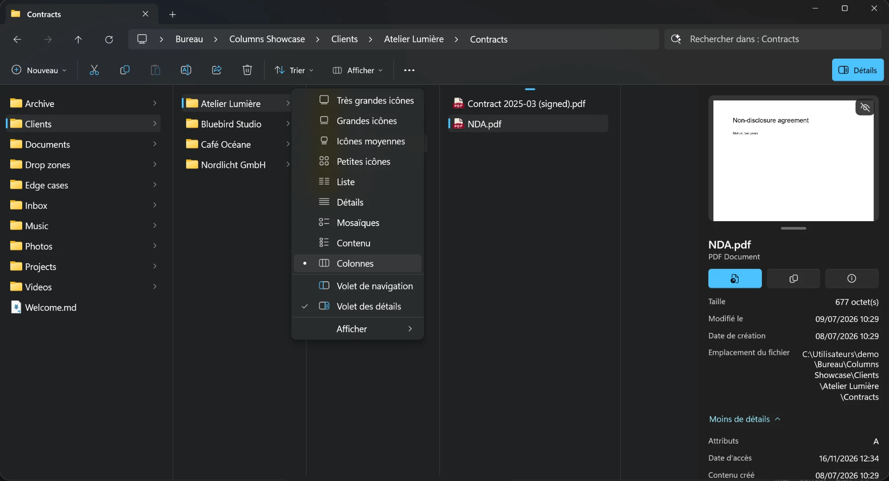

# Explorer Extras

A [Windhawk](https://windhawk.net) mod that adds to File Explorer on Windows 11. It is one mod with several areas, each with its own section and switch on the mod's page in Windhawk. Switch on what you want; the rest stays out of the way.

> **Beta, and vibe-coded.** Explorer Extras is in public beta, in daily use by its author, submitted to the Windhawk catalog and under review. It is built largely with AI assistance and tested by hand, without an independent code audit. Use it at your own judgment, and please report anything odd.

Tested daily on Windows 11 build 26100 (24H2) on ARM64, in French and English; x86-64 was tested up to 0.55. Removing the mod leaves Explorer as it was.

## Areas

| Area | What it does |
| --- | --- |
| **Columns** | A Columns layout in the View menu: Miller columns, one per folder level, with drag and drop, touch, a restyled context menu and per folder memory. [More](docs/columns.md) |
| **Details pane** | One pane in place of Explorer's Details and Preview panes: a real preview (PDF, text, Markdown, images, video, sound) and the details, in every view. |
| **Labels** | Colour labels, like the tags of macOS, on files and folders: dots in every view and in Columns, a Tags section in the details pane, a Tags entry in the right-click menu, and Explorer's own Sort and Group by Tags. They are kept in the file itself, on NTFS. [More](docs/labels.md) |
| **Toolbar** | Tighter navigation and command bar buttons, a search box you resize by dragging its edge (mouse, touch or pen), and round corners for the address bar and the search box. Each is a setting. |
| **Settings** | On the mod's page in Windhawk, in groups: Columns (Behaviour, Content, Layout, Memory), Details pane (Pane, Previews), Labels (Colour names), Toolbar and Limits. They apply at once. |

**Works with QuickLook.** Explorer's own view follows the active column, so [QuickLook](https://github.com/QL-Win/QuickLook) previews the selected item as it does in any other view.

More areas will come; see [`../ROADMAP.md`](../ROADMAP.md) for what is planned.



A short tour:

https://github.com/user-attachments/assets/14dddb22-8866-4082-aede-a6f5ed995bea

## Details pane

- Previews of PDF, text and code, Markdown, images (zoom, pan, animated GIF), video and sound.
- The details of what is selected, by type. A folder's size and contents are counted when you press **Calculate**, or by themselves if you turn that on in the settings.
- A fanned stack of thumbnails when several items are selected.
- Replaces Explorer's Details and Preview panes: Alt+P, the View menu and the toolbar button show and hide it.
- Each kind of preview can be switched off, and has a size limit, in the settings.

## Labels

- A label is a coloured dot with an optional name: seven colours and a neutral gray, up to 16 on an item. Dots show after the name, stacked when there are several, in every view of Explorer's list and in Columns, and follow the light and dark theme.
- Set them in the **Tags** section of the details pane, or in the right-click menu (a **Tags** entry with the colours, **Add tag** and **Clear tags**), in Explorer's own list and in Columns.
- They are kept in a named stream of the file, so they follow it when it is copied or moved on an NTFS drive, and the file's dates do not change. A drive that is not NTFS cannot keep them, and the pane and the menu say so.
- **Good to know:** Labels are written into the files themselves, so they stay there after the mod is disabled or uninstalled. They are also written on a network share that supports named streams. To take them off, use **Clear tags** (in the pane or the right-click menu) while the mod is still running.
- The **Add a tag** flyout lists your recent named tags, so a name is typed once.
- Explorer's own **Sort by**, **Group by** and **Tags** column use the labels: group a folder by Tags and each label is a group (an item with two labels is in both). Switch it off with **Sort and group by tags**.
- Each colour has a name you can edit on Windhawk's page, such as "Red = Urgent". Switch labels off with **Show labels**.

## Toolbar

- **Navigation buttons.** Back, Forward, Up and Refresh sit closer together (4 pixels by default, Explorer's is 16), and the address bar sits closer to them (4, Explorer's is 8); the address bar takes the room that frees.
- **Command bar.** The gap between New, Cut, Copy, Paste and the rest is a setting (4 pixels by default, Explorer's is 8).
- **Search box.** Drag the edge between the address bar and the search box to resize it, with the mouse, a finger or a pen. A double click or double tap goes back to the width in the settings; a width you drag is kept until you change that setting.
- **Corners.** A corner radius for the address bar and one for the search box, 0 to 16 (16 makes the ends round).
- **Switch it off** with **Change the toolbar**, and Explorer's own spacing, search box and corners come back.

## Install

1. Install [Windhawk](https://windhawk.net).
2. In Windhawk choose **Create a new mod**, replace the code with the contents of `explorer-extras.wh.cpp`, and compile it (Ctrl+B).
3. Enable the mod. For Columns, open the View menu of a File Explorer window and choose **Columns**. The details pane is on by default: it shows in place of Explorer's Details pane (Alt+P, the toolbar button or the View menu).

The mod hooks `FileExplorerExtensions.dll`. Windhawk must be able to download Microsoft's symbols for it, which has worked on every build tested. If symbols are missing right after a Windows update, the mod waits and logs it.

## Settings

The mod's page in Windhawk has a group per area, and the first setting of each is its off switch, so you can use only the part you like. A **Limits** group holds the largest folder a column lists, the largest document to preview, and the largest image to open at once. The full list is in [`docs/settings.md`](docs/settings.md). Settings apply at once, with no restart. A few behaviours are not options: following the active column, dragging items out, browsing archives, the marks of cloud, network and device items, and a click in the navigation pane making its folder the first column.

## Feedback

Found a bug, or have an idea? Open an issue: [bug report](https://github.com/AristideBH/windhawk-lib/issues/new?template=explorer-extras-bug.yml) or [feature suggestion](https://github.com/AristideBH/windhawk-lib/issues/new?template=explorer-extras-feature.yml). A bug report is easiest to follow with the mod's version, your Windows build and the log (Windhawk, the mod's Advanced tab, logging). How reports are handled is in [`FEEDBACK.md`](FEEDBACK.md).

## Support

Explorer Extras is free. If you like it, you can [support the work on Ko-fi](https://ko-fi.com/aristidebh).

## Build from source

The mod is one file for Windhawk but is kept in parts under `src/`, joined by a script:

```
python explorer-extras/build.py            # writes explorer-extras.wh.cpp
python explorer-extras/build.py --check    # exits 1 if the generated file is out of date
```

Edit the parts, never the generated file. `tools/deploy-explorer-extras.ps1` builds a test version that also writes a log file, compiles it with Windhawk's own compiler and deploys it (one administrator prompt), and `tools/smoke-test-explorer-extras.ps1` then opens a window and checks what the mod must have placed. `tools/crash-analysis/` reads an Explorer crash dump without a debugger. The workflow is in [`HANDOFF.md`](HANDOFF.md).

## More

- [`CHANGELOG.md`](CHANGELOG.md): what changed in each release.
- [`FEEDBACK.md`](FEEDBACK.md): how issues and suggestions are handled.
- [`HANDOFF.md`](HANDOFF.md): how the work is run, the architecture, and what costs time.
- [`PLAN.md`](PLAN.md): findings from the probes and the decisions behind the design.
- [`../ROADMAP.md`](../ROADMAP.md): what is done, tested and open.

## License

MIT.
