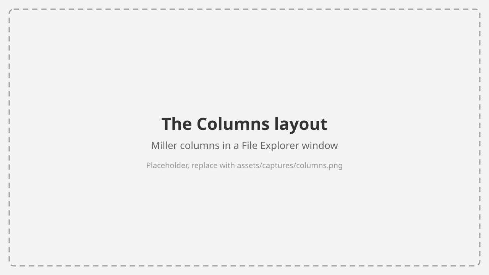
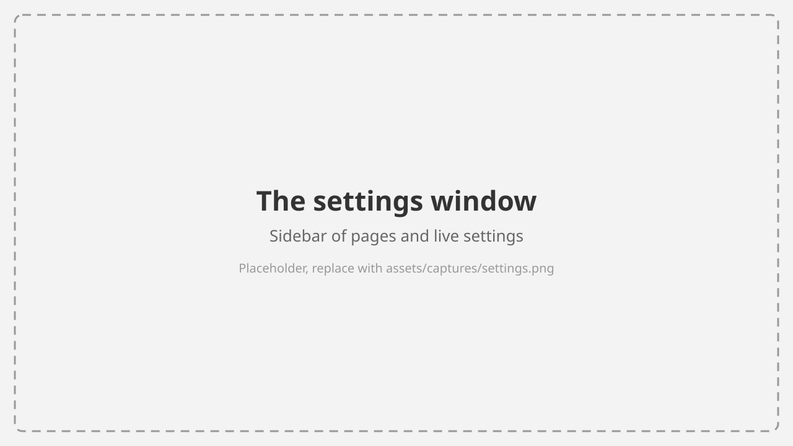

# Explorer Extras

A [Windhawk](https://windhawk.net) mod for File Explorer on Windows 11. It adds a **Columns** layout to the View menu: Miller columns, one column per folder level, drawn with Explorer's own WinUI 3 controls.

Status: version 0.36, release candidate, in daily use by its author, not yet published to the Windhawk catalog. Tested on Windows 11 build 26100 (24H2), ARM64, French. The x86-64 build compiles and links (checked with Windhawk's own compiler) but has not been run.



## What it does

- **Columns layout.** Choose Columns in Explorer's View menu. Each folder opens in the next column, with a chevron on folders. Explorer's own view follows the active column, so the address bar, tab title, toolbar, details pane and status bar act on the selection.
- **Native feel.** Sort and group come from Explorer's view. File icons, thumbnails and the context menu come from the shell. Right-click opens a restyled menu: a row of quick actions on top, the usual commands below, and "Show more options" for everything else. Submenus open on hover.
- **Keyboard.** Arrow keys, type to jump, Enter, Backspace, F2 (also for several items at once), Delete, Ctrl+C, X, V, Z, Y, Ctrl+Shift+N for a new folder, Ctrl+Alt+N for a new folder holding the selection.
- **Selection.** Drag a rectangle, Ctrl and Shift click, collapsible group headers.
- **Tabs.** Each tab keeps its own columns. A tab in another layout is left alone. Middle click on a folder, or "Open in new tab" in the menu, opens it in a new tab.
- **Per folder memory.** Each column remembers its sort and group, its width, and whether the folder is shown in Columns. All three can be switched off.
- **Drag and drop.** Drag rows onto a folder or into another column, out to the navigation pane, another Explorer window (any view), the desktop or another application, or drop files in from them. Ctrl copies, Shift moves, Alt makes a shortcut, Escape cancels. The shell does the work, so conflict and progress dialogs are Explorer's. A label with the icons, the name or count, and what a drop would do follows the pointer, the target row or column gets an accent frame, and columns scroll near their edges while dragging.
- **Widths.** Drag a border to resize a column, double-click it to fit the names, Shift and double-click to give every column the average fitted width. A small handle follows the pointer along the border.
- **Touch.** Tap, press and hold, drag and drop and a rubber band work by touch.
- **Look.** Selected neighbouring rows share one background, the chevron of the folder that leads to dimmed columns sits on a small badge, and the View button wears a Columns icon while Columns is on.
- **Archives.** Zip, 7z, rar and tar files open as folders in the next column, with Extract here and Extract selected here.
- **Undo.** Ctrl+Z takes back a delete, a rename, a new folder, or a group of renames.
- **Marks.** Cloud files that are not downloaded, always-kept and downloaded cloud files, network items and phones get a small glyph.

Not done yet: translations. See [`../ROADMAP.md`](../ROADMAP.md). `SHOWCASE-TESTS.md` describes a rich test folder built by `make-columns-showcase.ps1`.

## Install

1. Install [Windhawk](https://windhawk.net).
2. In Windhawk choose **Create a new mod**, replace the code with the contents of `explorer-extras.wh.cpp`, and compile it (Ctrl+B).
3. Enable the mod. Open the View menu of a File Explorer window and choose **Columns**.

The mod hooks `FileExplorerExtensions.dll`. Windhawk must be able to download Microsoft's symbols for it, which has worked on every build tested. If symbols are missing right after a Windows update, the mod waits and logs it.

## Settings

Open the settings window from **Extras** at the bottom of the toolbar's ... menu, or from the View menu. Settings apply at once. The same settings are on the mod's page in Windhawk.



| Setting | Default | What it does |
| --- | --- | --- |
| Enable Columns | on | Adds Columns to the View menu. |
| Open new windows in Columns | on | New windows open in Columns if it was your last layout. |
| Keep columns after choosing a file | on | Columns to the right stay, dimmed. Off closes them. |
| Sidebar sets the first column | off | A click on Home, Gallery, OneDrive or a pinned folder starts the columns there. |
| Keyboard on group headers | off | Arrow keys reach group headers. |
| Double-click empty space to go up | off | Goes up one folder. |
| Remember sort and grouping, column widths, Columns per folder | on | The per folder memory. |
| Open folders while dragging | on | Hold dragged items on a folder for about 0.7 s to open it. |
| Border after the last column | off | Draws a separator on the right of the last column. |
| Shift + double-click to even widths | on | Gives all columns the same width. |
| Show the focus outline | on | Outline around the item under the keyboard cursor. |
| Panel background | Explorer colour | Explorer's file list colour, or the theme colour. |
| Minimum / maximum column width | 160 / 420 | Column width range, in pixels. |
| Maximum items per column | 5000 | Most rows shown per folder. |
| Desktop column shows real items only | off | Hides This PC, Recycle Bin and other virtual items. |
| Mark remote items | on | Icons for cloud-only, network and phone items. |
| Write a debug log | off | Writes a log file for debugging. |

Following the active column, dragging items out of the panel and browsing archives are always on.

## Build from source

The mod is one file for Windhawk but is kept in parts under `src/`, joined by a script:

```
python explorer-extras/build.py            # writes explorer-extras.wh.cpp
python explorer-extras/build.py --check    # exits 1 if the generated file is out of date
```

Edit the parts, never the generated file. A syntax-only check with Windhawk's own clang is described in [`HANDOFF.md`](HANDOFF.md).

## More

- [`HANDOFF.md`](HANDOFF.md): how the work is run, the architecture, and what costs time.
- [`PLAN.md`](PLAN.md): findings from the probes and the decisions behind the design.
- [`../ROADMAP.md`](../ROADMAP.md): what is done, tested and open.

## License

MIT.
