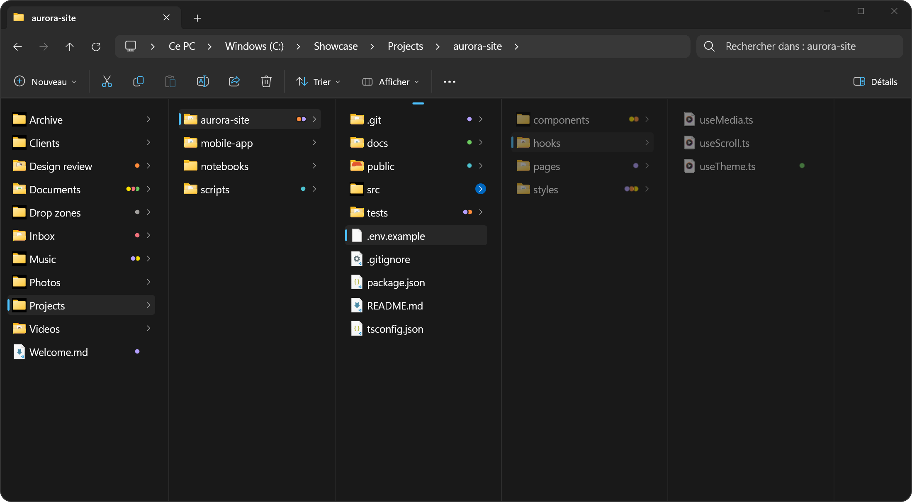
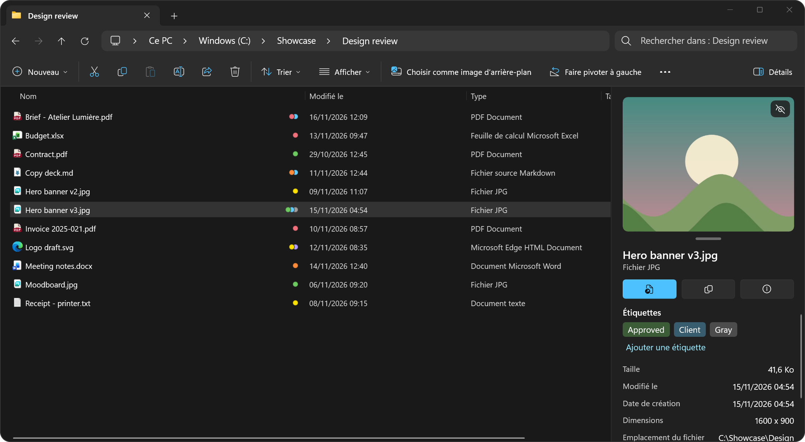
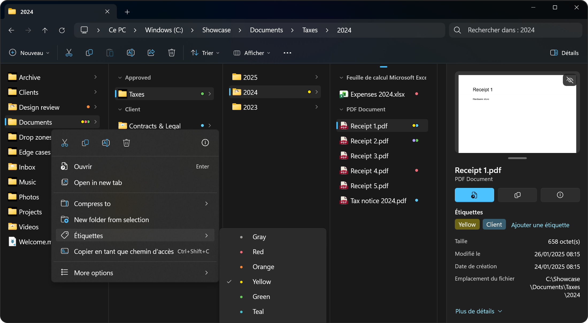

# Explorer Extras

**Extra features for File Explorer on Windows 11, one switch per feature.**

<video src="https://github.com/AristideBH/windhawk-lib/raw/main/explorer-extras/assets/captures/hero.mp4" poster="assets/captures/hero.png" controls muted loop playsinline width="100%"></video>

*A 40-second tour. If the video does not play here, [watch it directly](https://github.com/AristideBH/windhawk-lib/raw/main/explorer-extras/assets/captures/hero.mp4).*

Explorer Extras is a [Windhawk](https://windhawk.net) mod. It adds four independent features to File Explorer. Each has its own section and its own off switch on the mod's page in Windhawk: turn on what you like, and the rest stays out of the way.

| Feature | In one line |
| --- | --- |
| [**Columns**](#columns) | Miller columns in the View menu, with drag and drop, touch and per-folder memory. |
| [**Details pane**](#details-pane) | One pane for details and real previews of PDF, text, Markdown, images, video and sound. |
| [**Labels**](#labels) | Colour tags on files and folders, usable in Explorer's own Sort by and Group by. Off by default. |
| [**Sidebar**](#sidebar) | A navigation pane of Favorites, Locations and Tags, with a list of the files of each tag. Off by default. |

## Columns



*One column per folder level. The dots after the names are labels.*

Browse folders the way you do on a Mac: one column per folder level, side by side. Open the **View** menu of a File Explorer window and choose **Columns**.

- **It feels like Explorer.** Sorting, grouping, icons, thumbnails and the right-click menu all come from Windows itself. The menu is tidied up: quick actions on top, "Show more options" for the full list.
- **Keyboard, selection and undo.** Arrow keys, type to jump, F2 (also for several items at once), Delete, copy and paste, a rubber band, and Ctrl+Z to take back a delete, a rename or a new folder.
- **Drag and drop, and touch.** Between columns, into the navigation pane, to other windows and apps, and back. Tap, hold, drag and select with a finger.
- **Tabs and memory.** Each tab keeps its own columns, and each folder remembers its sort, its grouping, its column widths and whether you showed it in Columns.
- **Archives.** Zip, 7z, rar and tar files open like folders.

## Details pane



*The details pane beside Explorer's own list: a preview, the labels of the selected file and its details.*

One pane that replaces Explorer's Details and Preview panes, in Columns and in every view. Press **Alt+P**, or use the View menu or the toolbar button, to show or hide it.

- **Real previews.** PDF, text and code, Markdown, images (zoom, pan, animated GIF), video and sound.
- **Details by type.** A folder's size and contents are counted when you press **Calculate**, or by themselves if you turn that on.
- **Several files at once.** A fanned stack of thumbnails.
- **You stay in control.** Each kind of preview can be switched off, and has a size limit.

## Labels



*Columns grouped by label, the **Tags** entry (**Étiquettes** in French) of the right-click menu, and the Tags section of the pane.*

Colour labels, like the tags of macOS, on files and folders.

- **Colours and names.** Seven colours and a neutral gray, an optional name, up to 16 on an item. Give each colour a meaning in the settings, such as "Red = Urgent".
- **Seen everywhere.** A dot after the name, in every view of Explorer's list and in Columns, in step with the light or dark theme.
- **Easy to set.** In the **Tags** section of the details pane, or from the right-click menu: a **Tags** entry with the colours, **Add tag** and **Clear tags**. The last eight names you typed are listed, so you type each one once.
- **Sort and group.** Explorer's own **Group by** and **Sort by** use them: choose **Tags** (**Étiquettes** in French; under **More** for Sort by) and each label becomes a group. An item with two labels is in both groups.
- **They follow the file.** A label is stored in the file itself, so it survives copying or moving on NTFS drives, and the file's dates do not change. See "Good to know" below.

## Sidebar

A sidebar in place of Explorer's navigation pane, off until you turn on **Replace the navigation pane**.

- **Favorites, Locations, Tags.** Pinned folders, Home, This PC with its drives and devices, and your labels as tags.
- **Pin by drop, reorder by drag.** Drop a folder to pin it, drop files on a tag to label them, drag rows to reorder.
- **Tag lists.** A tag opens every file that has it, across your local drives, in a sortable list. Rename, recolour or delete a tag everywhere at once.
- **Options.** File counts, free space and an eject button on drives, keyboard use.

More in [`docs/sidebar.md`](docs/sidebar.md).

## Toolbar tweaks, now elsewhere

Up to 1.0.21 the mod also tightened the toolbar. That part has moved out: the spacing and round corners are a ready-made config for [Windows 11 File Explorer Styler](docs/toolbar-styler.md), and resizing the search box by dragging is the [Explorer Search Box Resize](../explorer-search-box-resize/explorer-search-box-resize.wh.cpp) mod.

## Install

1. Install [Windhawk](https://windhawk.net).
2. In Windhawk, open **Explore**, search for **Explorer Extras** and click **Install**. The mod is also on its catalog page: https://windhawk.net/mods/explorer-extras
3. Enable the mod, then open a File Explorer window. For Columns, use the **View** menu and choose **Columns**. The details pane replaces Explorer's own Details pane: press **Alt+P**.

Not in the catalog yet, or you want to build it yourself? In Windhawk choose **Create a new mod**, replace the code with the contents of [`explorer-extras.wh.cpp`](explorer-extras.wh.cpp), and compile it (Ctrl+B).

The mod needs Windhawk to download the symbols of `FileExplorerExtensions.dll`, which has worked on every Windows build tested. If symbols are missing right after a Windows update, the mod waits and logs it.

## Settings

The mod's page in Windhawk has a group per feature, and the first setting of each is its off switch. A **Limits** group holds the largest folder a column lists, the largest document to preview and the largest image to open at once. Settings apply at once, with no restart. The full list is in [`docs/settings.md`](docs/settings.md).

## Good to know

- **Labels stay in your files.** Labels are off by default, because they are the one part of the mod that changes files: turn on **Show labels** to use them. They are written into the files themselves (an NTFS stream), so they stay there after the mod is disabled or uninstalled, and also on a network share that supports named streams. To take them off, use **Clear tags** (in the pane or the right-click menu) while the mod is still running.
- **Removing the mod** leaves Explorer as it was, apart from those labels.
- **Works with QuickLook.** Explorer's own view follows the active column, so [QuickLook](https://github.com/QL-Win/QuickLook) previews the selected item as it does anywhere else.
- **Tested** daily on Windows 11 24H2 (build 26100) on ARM64, in French and English. x86-64 was tested up to version 0.55.
- **Built with AI assistance** (Claude Code) under the author's direction, and tested by hand. It has not had an independent code audit, so please report anything odd.

## Feedback

Found a bug, or have an idea? Open an issue: [bug report](https://github.com/AristideBH/windhawk-lib/issues/new?template=explorer-extras-bug.yml) or [feature suggestion](https://github.com/AristideBH/windhawk-lib/issues/new?template=explorer-extras-feature.yml). A bug report is easiest to follow with the mod's version, your Windows build and the log (Windhawk, the mod's **Advanced** tab, logging). How reports are handled is in [`FEEDBACK.md`](docs/FEEDBACK.md).

## Support

Explorer Extras is free. If you like it, you can [support the work on Ko-fi](https://ko-fi.com/aristidebh).

## For developers

The mod is one file for Windhawk but is kept in parts under `dev/src/`, joined by a script:

```
python explorer-extras/dev/build.py            # writes explorer-extras.wh.cpp
python explorer-extras/dev/build.py --check    # exits 1 if the generated file is out of date
```

Edit the parts, never the generated file. `tools/deploy-explorer-extras.ps1` builds a test version that also writes a log file, compiles it with Windhawk's own compiler and deploys it (one administrator prompt), and `tools/smoke-test-explorer-extras.ps1` then opens a window and checks what the mod must have placed. `tools/crash-analysis/` (at the root of the repository) reads an Explorer crash dump without a debugger.

- [`CHANGELOG.md`](CHANGELOG.md): what changed in each release.
- [`FEEDBACK.md`](docs/FEEDBACK.md): how issues and suggestions are handled.
- [`HANDOFF.md`](dev/HANDOFF.md): how the work is run, the architecture, and what costs time.
- [`PLAN.md`](dev/PLAN.md): findings from the probes and the decisions behind the design.
- [`../ROADMAP.md`](../ROADMAP.md): what is done, tested and open.

## License

MIT.
