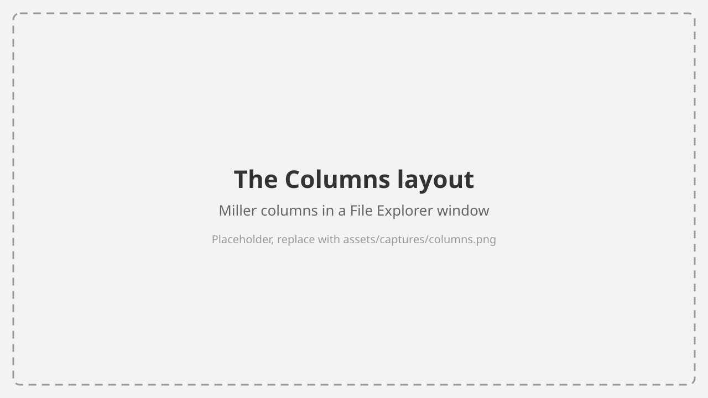

# Columns

A **Columns** layout in File Explorer's View menu: Miller columns, one column per folder level, drawn with Explorer's own WinUI 3 controls. Choose Columns in the View menu of an Explorer window. Each folder opens in the next column, with a chevron on folders. Explorer's own view follows the active column, so the address bar, tab title, toolbar, panes and status bar act on the selection.

## Look and feel

- **Native feel.** Sort and group come from Explorer's view. File icons, thumbnails and the context menu come from the shell.
- **Look.** Selected neighbouring rows share one background. The chevron of the folder that leads to dimmed columns sits on a small accent badge. The View button wears a Columns icon while Columns is on. Folders can be listed first, and every other row can be shaded.
- **Widths.** Drag a border to resize a column, double-click it to fit the names, Shift and double-click to give every column the average width.
- **Marks.** Cloud files that are not downloaded, always-kept and downloaded cloud files, network items and phones get a small glyph.

## Using it

- **Context menu.** Right-click opens a restyled menu: a row of quick actions on top, the usual commands below, and "Show more options" for everything else. Submenus open on hover.
- **Keyboard.** Arrow keys, type to jump, Enter, Backspace, F2 (also for several items at once), Delete, Ctrl+C, X, V, Z, Y, Ctrl+Shift+N for a new folder, Ctrl+Alt+N for a new folder holding the selection.
- **Selection.** Drag a rectangle, Ctrl and Shift click, collapsible group headers. A slow second click on the selected item of the active column renames it.
- **Tabs.** Each tab keeps its own columns. A tab in another layout is left alone. Middle click on a folder, or "Open in new tab" in the menu, opens it in a new tab.
- **Per folder memory.** Each column remembers its sort and group, its width, and whether the folder is shown in Columns. All three can be switched off.
- **Archives.** Zip, 7z, rar and tar files open as folders in the next column, with Extract here and Extract selected here.
- **Undo.** Ctrl+Z takes back a delete, a rename, a new folder, or a group of renames.

## Drag and drop

Drag rows onto a folder or into another column, out to the navigation pane, another Explorer window (any view), the desktop or another application, or drop files in from them. Ctrl copies, Shift moves, Alt makes a shortcut, Escape cancels. The shell does the work, so conflict and progress dialogs are Explorer's. A label with the icons, the name or count, and what a drop would do follows the pointer. The target gets an accent frame, and columns scroll near their edges while dragging.

## Touch

Tap, press and hold, drag and drop and a rubber band work by touch. A drag that starts on the empty space of a column and goes mostly sideways scrolls the columns; any other direction draws the selection rectangle. A second finger gives the rectangle up for the system's two-finger scroll.

## Settings

The Columns switches are listed in [`settings.md`](settings.md). `SHOWCASE-TESTS.md` (one level up) describes a rich test folder built by `make-columns-showcase.ps1`.
